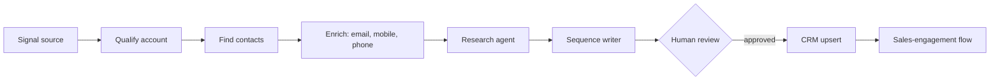

# Clay Agent Workflow

[](https://www.python.org/)
[](#requirements)

A GTM engineering toolkit for running AI-assisted outbound on [Clay](https://clay.com), driven from the Clay CLI
and Claude Code. It is a sanitized extract of tooling used in production: the reusable builders, runners and API
notes, with no customer or prospect data.

## The pipeline



## Design principles

- **Gate before you spend.** Free filters and qualification run first, so paid research and enrichment only touch survivors.
- **Waterfall enrichment with validation.** Several providers in sequence, each result validated before it is accepted.
- **Humans approve what sends.** Samples are reviewed before enrollment, and spend is approved per batch. The runner
  refuses to approve a spend request for any workflow other than the one it started (see `tests/test_wf_batch.py`).
- **Idempotent builds.** Workflow builders cache node ids, so a re-run updates rather than duplicates.
- **Resilient CLI calls.** Transient server errors are retried with backoff; every other error fails fast.

## Repository layout

| Path | Purpose |
|---|---|
| `tools/clay_build.py` | Workflow builder: node factory, email and mobile waterfalls, CRM write nodes |
| `tools/wf_batch.py` | CSV-to-workflow batch runner with field mapping and an explicit spend-approval gate |
| `tools/batch_run.py` | Launch and poll a list of leads through a workflow |
| `tools/clay_mcp_call.py` | stdio JSON-RPC bridge to Clay's local MCP server, for scripting its tools |
| `tools/code_test_local.py` | Run a workflow code node locally when the CLI's daily test cap is hit |
| `tools/clay_cli.py` | Single place that locates the Clay CLI |
| `tests/` | Unit tests, standard library only |
| `searches/` | Example saved ICP people-search filters |
| `docs/clay-workflow-api-learnings.md` | How the Clay workflow-editor API actually behaves, including failure modes that cost credits |

IDs in `clay_build.py` (connections, owner) are placeholders. Replace them with your own workspace's values.
Per-campaign builders that import it are not part of this extract.

## Quickstart

```bash
clay whoami && clay credits balance
clay search filters-mode create --source-type people --filters "$(cat searches/icp-new-exec-hires.json)"
python3 tools/batch_run.py leads.json wf_YOUR_WORKFLOW_ID
```

Test a workflow code node locally, without spending a CLI test run:

```bash
python3 tools/code_test_local.py node.py outputs.json inputs.json --show
```

## Development

```bash
make test
```

## Requirements

Python 3.9 or newer and the Clay CLI. There are no third-party Python dependencies.
